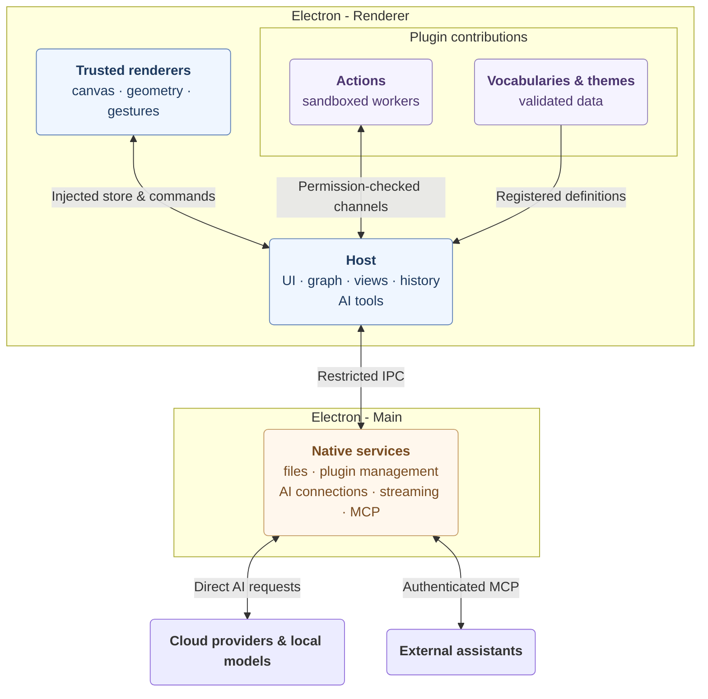

<div align="center">


</br>
A second brain for connecting ideas and building understanding in one knowledge graph, with AI assistance. Built on a small core with a simple plugin system.
</br></br>

[](https://github.com/nesso-how/nesso/actions/workflows/ci.yml)
[](https://github.com/nesso-how/nesso/releases)
[](https://github.com/nesso-how/nesso/discussions)

</div>

> [!WARNING]
> This is pre-alpha software. Stored formats may change without migrations.
>
> Windows installers are currently unsigned and may trigger SmartScreen warnings.

## Install

Nesso is primarily a desktop app for **macOS, Windows, and Linux**. Download it from [nesso.how](https://nesso.how) or [GitHub releases](https://github.com/nesso-how/nesso/releases).

The [web demo](https://app.nesso.how) lets you try the graph editor in your browser. AI assistance, plugin installation, and the local MCP server are available in the desktop app.

## Usage

We often understand and remember through associations: one idea brings another to mind, and new knowledge gains meaning through what we already know. Nesso gives you a place to map these associations, follow the relations between ideas, and build on them.

Your knowledge lives in **one graph**: your second brain. **Views** let you focus on a project, question, or theme without splitting that knowledge into separate copies. The same concept can appear in several views, with edits shared across them.

Nesso keeps things minimal and efficient, with just a few key elements:

- **Concepts** represent ideas. You can change their color, make their labels bold or italic, and add a plain-text description.
- **Relations** connect concepts with a direction and a type that describes the connection.
- **Views** offer different perspectives on the same graph. The default **All** view contains the complete graph and cannot be deleted. Saved views are named subsets of its concepts.
- **Vocabularies** provide relation types. You can name your own relation types or define vocabularies as plugins.
- **Plugins** are npm packages providing vocabularies, themes, or actions on the current view. Install them from Settings → Plugins on desktop, or [create your own](packages/plugin/README.md#create-a-plugin).
- **AI** helps you explore, expand, and organize your graph on desktop. Chat using your own API key (BYOK), a local model, or ChatGPT sign-in, or connect external assistants through the local MCP server. See the [AI guide](packages/ai/README.md).

Use the Explorer to navigate views, the canvas to build the graph, and the Inspector to edit the selection, manage views, or chat with AI on desktop.

## Architecture



Nesso keeps a small core responsible for the document and the rules for changing it. Every edit goes through the same validation and history mechanism, whether it starts with a user gesture, a plugin action, or an AI request. Changes are applied atomically, so a failed edit leaves the document intact.

Renderers and plugins build on those rules through explicit contracts. A renderer can shape how you work with the graph without redefining editing policy. Plugins receive a scoped view of the data and request operations from the host, which checks their permissions before acting. They never access app internals directly. Contributions that only need data, such as a vocabulary or a theme, require no executable code.

Native privileges sit behind a narrow desktop bridge that exposes specific operations rather than unrestricted system access. This keeps the document model independent of the operating system and AI provider, and lets the same app core run in the browser. New capabilities can be added at these boundaries without making them dependencies of the core.

## Documentation

The app lives in `src/`, with desktop services in `electron/`. Shared packages live in `packages/`: **Core** packages provide contracts and reusable building blocks, while **Renderer** packages provide trusted graph interfaces. Bundled **Plugin** packages live in `plugins/` and deliberately use the same contracts as external plugins, so Nesso tests those contracts through its own everyday features before others build on them. Each package links to its own README below.

| Package | Kind | Responsibility |
| --- | --- | --- |
| [`@nesso-how/schema`](packages/schema/README.md) | Core | Graph model, validation, and JSON-LD. |
| [`@nesso-how/plugin`](packages/plugin/README.md) | Core | Public types, plugin validation, and asynchronous clients. |
| [`@nesso-how/errors`](packages/errors/README.md) | Core | Shared structured errors with issue paths and messages. |
| [`@nesso-how/i18n`](packages/i18n/README.md) | Core | i18next with typed keys, isolated translators, and English fallback. |
| [`@nesso-how/ui`](packages/ui/README.md) | Core | Shared React controls and styles. |
| [`@nesso-how/ai`](packages/ai/README.md) | Core | Shared chat and MCP tool contracts, policies, and assistant instructions. |
| [`@nesso-how/concept-map`](packages/concept-map/README.md) | Renderer | Trusted React Flow canvas for the host-provided visible graph. |
| [`@nesso-how/base-vocab`](plugins/base-vocab/README.md) | Plugin | Default relation vocabulary. |
| [`@nesso-how/export`](plugins/export/README.md) | Plugin | Graph and view export as JSON-LD. |
| [`@nesso-how/import`](plugins/import/README.md) | Plugin | Merge a Nesso JSON-LD file into the current graph. |
| [`@nesso-how/kernel-theme`](plugins/kernel-theme/README.md) | Plugin | Kernel theme tokens and bundled fonts. |
| [`@nesso-how/paper-theme`](plugins/paper-theme/README.md) | Plugin | Warm ivory surfaces and restrained terracotta accents. |

For a complete action package you can build and install, see the [standalone plugin example](packages/plugin/example/README.md).

## Development

Use Node.js 24 and the pnpm version specified in [`package.json`](package.json). Install dependencies, then build and run the desktop app:

```sh
pnpm install
pnpm desktop
```

For desktop development with live reload, run `pnpm dev --host 127.0.0.1 --strictPort` and `pnpm desktop:dev` in separate terminals. For the web demo alone, use `pnpm dev`.

Checks: `pnpm build`, `pnpm lint`, `pnpm test`, `pnpm test:plugin-runtime`, and `pnpm analyze --summary`.

See the [plugin guide](packages/plugin/README.md#create-a-plugin) for plugin authoring, or `pnpm release --help` for release options.

## Troubleshooting

If a suspected plugin problem prevents startup, quit Nesso completely and relaunch it with `--safe-plugins`:

- **macOS:** `open -a Nesso --args --safe-plugins`
- **Windows (PowerShell):** `& "C:\path\to\Nesso.exe" --safe-plugins`
- **Linux:** `nesso --safe-plugins`, or `./Nesso-<version>-<arch>.AppImage` for an AppImage.

Installed packages and documents are preserved. Quit and relaunch without the flag to resume normal operation.

## License

[MIT](LICENSE) © 2026 Omar Desogus and Paolo Manfredotti.
