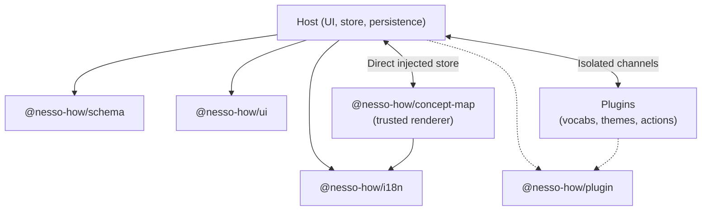

<div align="center">


</br>
A second brain for connecting ideas and building understanding in one knowledge graph, with AI assistance. Built on a small core with a simple plugin system.
</br></br>

[](https://github.com/nesso-how/nesso/actions/workflows/ci.yml)
[](https://github.com/nesso-how/nesso/releases)
[](https://github.com/nesso-how/nesso/discussions)

</div>

> [!WARNING]
> This is pre-alpha software. Stored formats may change without migrations.
>
> Windows installers are currently unsigned and may trigger SmartScreen warnings.

## Install

Nesso is primarily a desktop app for **macOS, Windows, and Linux**. Download it from [nesso.how](https://nesso.how) or [GitHub releases](https://github.com/nesso-how/nesso/releases).

The [web demo](https://app.nesso.how) lets you try the graph editor in your browser, without AI assistance or the local MCP server.

## Usage

Your knowledge lives in one graph.

- **Concepts** represent ideas, connected by directed, typed **relations**.
- **Views** are named subsets of that graph.
- **Vocabularies** provide relation types. You can also name your own.
- **Plugins** provide vocabularies, themes, and actions on the current view. The canvas is a trusted Nesso renderer.

Use the Explorer to navigate views, the canvas to build the graph, and the Inspector to edit the selection and its memberships.

Concepts can have an optional plain-text description, edited in the Inspector and shared across views. Descriptions stay off the canvas.

### AI

In the desktop app, use **AI** with your own provider or a local model, or connect an external assistant through the local MCP server. Provider credentials are encrypted on your device, and chat requests go directly to the chosen endpoint. Graph edits are validated and undoable, with approvals handled inside Nesso.

- **OpenAI**: API key or ChatGPT sign-in (OAuth, paid plan required: Go, Plus, or Pro).
- **Anthropic, Gemini, OpenRouter**: API key.
- **OpenAI-compatible endpoints**: hosted or local models, with an optional API key.
- **External assistants**: connect through the local MCP server.

## Architecture



The host owns state, materializes `viewGraph`, and handles deletion confirmation, clipboard access, and shortcut routing. The trusted renderer owns geometry and gestures, updates selection through the store, and delegates deletion and clipboard actions to the host; plugins use isolated, validated channels. Settings → Plugins manages external npm packages through the desktop bridge; web runs bundled plugins only. Dashed arrows show shared contract types.

| Package | Kind | Responsibility |
| --- | --- | --- |
| [`@nesso-how/schema`](packages/schema/README.md) | Core | Graph model, validation, and JSON-LD. |
| [`@nesso-how/plugin`](packages/plugin/README.md) | Core | Public types, plugin validation, and asynchronous clients. |
| [`@nesso-how/i18n`](packages/i18n/README.md) | Core | i18next with typed keys, isolated translators, and English fallback. |
| [`@nesso-how/ui`](packages/ui/README.md) | Core | Shared React controls and styles. |
| [`@nesso-how/ai`](packages/ai/README.md) | Core | Shared chat and MCP tool contracts, policies, and assistant instructions. |
| [`@nesso-how/concept-map`](packages/concept-map/README.md) | Renderer | Trusted React Flow canvas for the host-provided visible graph. |
| [`@nesso-how/base-vocab`](plugins/base-vocab/README.md) | Plugin | Default relation vocabulary. |
| [`@nesso-how/export`](plugins/export/README.md) | Plugin | Graph and view export as JSON-LD. |
| [`@nesso-how/import`](plugins/import/README.md) | Plugin | Merge a Nesso JSON-LD file into the current graph. |
| [`@nesso-how/kernel-theme`](plugins/kernel-theme/README.md) | Plugin | Kernel theme tokens and bundled fonts. |
| [`@nesso-how/paper-theme`](plugins/paper-theme/README.md) | Plugin | Warm ivory surfaces and restrained terracotta accents. |

## Development

Use Node.js 24 and the pnpm version specified in [`package.json`](package.json).

```sh
pnpm install
pnpm desktop
```

`pnpm desktop` builds and runs the desktop app. Use `pnpm dev` to run the web demo locally.

Build and checks: `pnpm build`, `pnpm lint`, `pnpm test`, `pnpm test:plugin-runtime`, `pnpm analyze`.

Test scripts: `pnpm test:unit` for unit tests, `pnpm test:integration` for Node integration tests, and `pnpm test:plugin-runtime` for plugin runtime integration tests. `pnpm test` runs both Node test groups.

Use `pnpm analyze --summary` for a compact Fallow report. Duplication and complexity are advisory.

For desktop development, run `pnpm dev --host 127.0.0.1 --strictPort` and `pnpm desktop:dev` in separate terminals.

For release instructions, run `pnpm release --help`.

### Create a plugin

Plugins contribute vocabularies, actions, or themes. Renderers are trusted Nesso packages, not installable plugins.
See the [plugin guide](packages/plugin/README.md#create-a-plugin) to get started.

## Troubleshooting

If a suspected plugin problem prevents startup, quit Nesso completely and relaunch it with `--safe-plugins`:

- **macOS:** `open -a Nesso --args --safe-plugins`
- **Windows (PowerShell):** `& "C:\path\to\Nesso.exe" --safe-plugins`
- **Linux:** `nesso --safe-plugins`, or `./Nesso-<version>-<arch>.AppImage` for an AppImage.

Installed packages and documents are preserved. Quit and relaunch without the flag to resume normal operation.

## License

[MIT](LICENSE) © 2026 Omar Desogus and Paolo Manfredotti.
