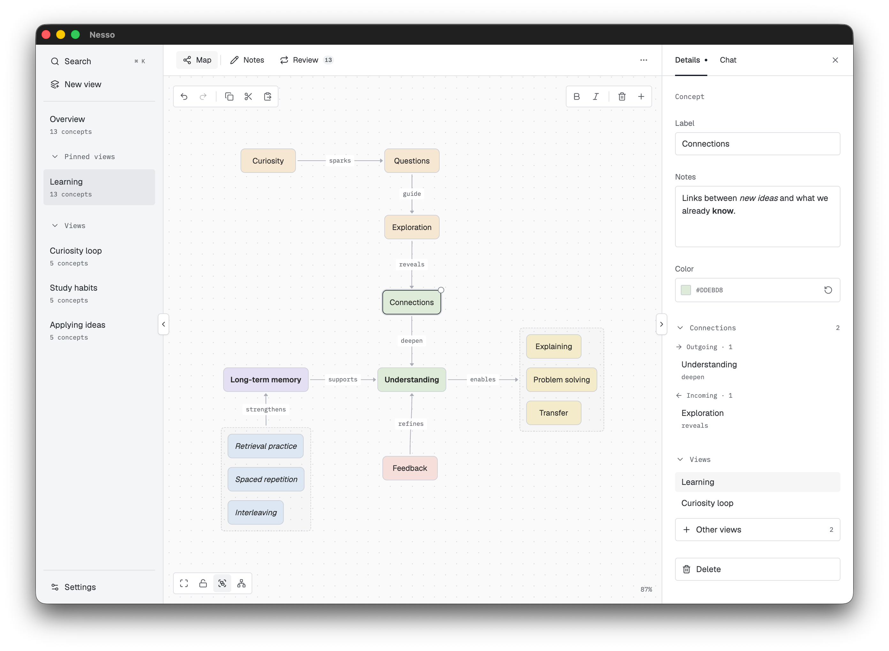
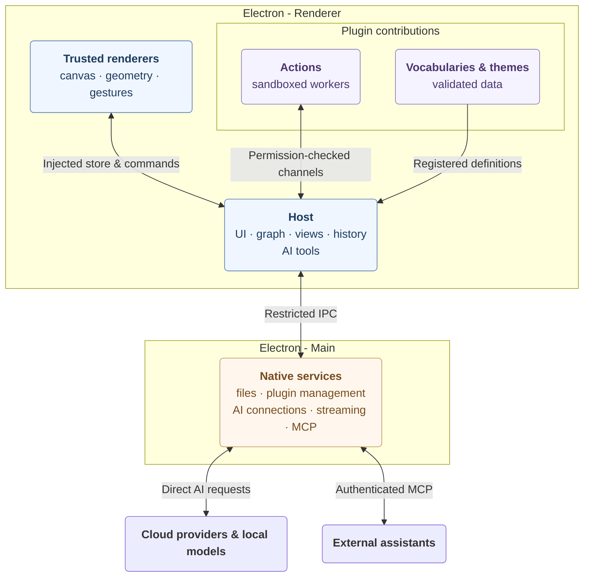

<div align="center">


</br>
A desktop app for learning, with a personal knowledge graph that grows with you. Connect ideas, work through them in notes, and review what you’ve learned.
</br></br>

[](https://github.com/nesso-how/nesso/actions/workflows/ci.yml)
[](https://github.com/nesso-how/nesso/releases)
[](https://github.com/nesso-how/nesso/discussions)

</div>

We often understand and remember through associations: one idea brings another to mind, and new knowledge gains meaning through what we already know. Nesso gives you a place to map these associations, follow the relations between ideas, and build on them.

Your knowledge isn’t scattered across files and folders but lives in **one connected graph that grows with your understanding**. **Views** let you focus on a project, question, or theme without splitting that knowledge into separate copies. The same concept can appear in several views, with edits shared across them.



Nesso keeps things minimal and efficient, with just a few key elements:

- **Concepts** represent ideas. They have a label and Markdown notes (bold, italic, lists, links).
- **Relations** connect concepts with a direction and a type that describes the connection.
- **Views** offer different perspectives on the same graph. The default **Overview** view contains the complete graph and cannot be deleted. Saved views are named subsets of its concepts, each with its own positions, colors, and bold or italic labels.
- **Vocabularies** provide relation types. You can name your own relation types or define vocabularies as plugins.
- **Plugins** add vocabularies, themes, and actions. They can also work as mini-apps inside Nesso, with their own interface and persistent data. Install published packages from Settings → Plugins on desktop, or [create your own with an agent](packages/plugin/README.md#create-a-plugin) and approve a local install through MCP, without publishing to npm. Nesso’s built-in plugins use the same system:
  - **Review** for FSRS spaced repetition over a view’s concepts.
  - **Notes** live-preview Markdown editor for each view’s project notes and brainstorming.
- **AI** helps you explore, expand, and organize your graph on desktop. Chat using your own API key (BYOK), a local model, or ChatGPT sign-in, or connect external assistants through the local MCP server.
- **Automatic backups** keep the latest 10 copies of your work on desktop, saved every 15 minutes and before a reset or restore. Choose a backup folder or restore a copy in Settings → Local data → Backup.

Use the Explorer to navigate views, the canvas to build the graph, and the Inspector to edit the selection, manage views, or chat with AI on desktop.

> [!WARNING]
> Windows installers are currently unsigned and may trigger SmartScreen warnings.

## Install

Nesso is primarily a desktop app for **macOS, Windows, and Linux**. Download it from [nesso.how](https://nesso.how) or [GitHub releases](https://github.com/nesso-how/nesso/releases).

The [web demo](https://app.nesso.how) lets you try the graph editor in your browser. AI assistance, plugin installation, and the local MCP server are available in the desktop app.

## Architecture



Nesso is organized around a small core, trusted renderers, and plugins:

- **Core** owns application state and editing rules.
- **Renderers** handle graph presentation and gestures.
- **Plugins** contribute actions, vocabularies, and themes through explicit contracts.

On desktop, these run in Electron’s renderer process, while the main process handles native services such as file access, plugin management, AI credentials, and provider connections.

All graph edits go through one API: `applyOperations`. The UI, trusted renderers, AI tools, and plugin actions submit ordered batches, directly or through convenience helpers built on the same API. The host validates each complete batch before publishing a single atomic update: either the changes succeed together, or state and history remain unchanged. Plugin permissions are checked before operations reach this shared editing path.

The same mechanism supports efficient, delta-based undo and redo. History records only what changed instead of storing a full copy of the graph for every edit. AI-generated edits also use this shared history and can be undone or redone just like manual changes.

The [compatibility guide](docs/compatibility.md) covers data migrations, plugin API support, downgrades, and data formats.

### Plugins

Plugins are central to Nesso’s design. They let the project grow through community contributions, adding new capabilities while keeping the core small and focused.

Plugins contribute actions, vocabularies, and themes. Actions run in isolated workers or open plugin-owned interactive UI in a sandboxed central panel, using permission-checked APIs for graph operations and private storage scoped to each plugin and document. The host owns panel navigation, lifecycle, and storage persistence separately from graph data and history. Vocabularies and themes are validated data and require no executable code.

The [plugin SDK](packages/plugin/) provides TypeScript contracts, validation, and clients for building plugins. Bundled and external plugins use the same contracts and runtime.

For a complete action package you can build and install, see the [standalone plugin example](packages/plugin/example/).

### AI

AI in Nesso is a supporting tool, not a replacement for the process of learning and building knowledge. It can help you explore ideas, find connections, and organize your graph, while you remain responsible for questioning, understanding, and deciding what belongs in it.

On desktop, chat with your own API key (BYOK), a local model, or ChatGPT sign-in, or connect an external assistant through the local MCP server. Provider credentials are encrypted on your device, and requests go directly to the chosen endpoint. Graph edits are validated and undoable.

## Code organization

The app lives in `src/`, with desktop services in `electron/`. Shared packages live in `packages/`: **Core** packages provide contracts and reusable building blocks, while **Renderer** packages provide trusted graph interfaces. Bundled **Plugin** packages live in `plugins/` and deliberately use the same contracts as external plugins, so Nesso tests those contracts through its own everyday features before others build on them.

| Package                                            | Kind     | Responsibility                                                            |
| -------------------------------------------------- | -------- | ------------------------------------------------------------------------- |
| [`@nesso-how/schema`](packages/schema/)            | Core     | Graph model, validation, and JSON-LD.                                     |
| [`@nesso-how/core`](packages/core/)                | Core     | Shared state, operation and store contracts, and write helpers.           |
| [`@nesso-how/plugin`](packages/plugin/)            | Core     | Plugin contracts, validation, and asynchronous clients.                   |
| [`@nesso-how/errors`](packages/errors/)            | Core     | Shared structured errors with issue paths and messages.                   |
| [`@nesso-how/i18n`](packages/i18n/)                | Core     | i18next with typed keys, isolated translators, and English fallback.      |
| [`@nesso-how/ui`](packages/ui/)                    | Core     | Shared React controls and styles.                                         |
| [`@nesso-how/ai`](packages/ai/)                    | Core     | Shared chat and MCP tool contracts, policies, and assistant instructions. |
| [`@nesso-how/concept-map`](packages/concept-map/)  | Renderer | Trusted React Flow canvas for the host-provided visible graph.            |
| [`@nesso-how/base-vocab`](plugins/base-vocab/)     | Plugin   | Default relation vocabulary.                                              |
| [`@nesso-how/export`](plugins/export/)             | Plugin   | Graph and view export as JSON-LD or PNG.                                  |
| [`@nesso-how/import`](plugins/import/)             | Plugin   | Merge a Nesso JSON-LD file into the current graph.                        |
| [`@nesso-how/review`](plugins/review/)             | Plugin   | Isolated concept review with FSRS and private concept-scoped progress.    |
| [`@nesso-how/notes`](plugins/notes/)               | Plugin   | Free-form Markdown notes scoped to each view, with autosave.              |
| [`@nesso-how/kernel-theme`](plugins/kernel-theme/) | Plugin   | Kernel theme tokens.                                                      |
| [`@nesso-how/paper-theme`](plugins/paper-theme/)   | Plugin   | Warm ivory surfaces and restrained terracotta accents.                    |
| [`@nesso-how/mist-theme`](plugins/mist-theme/)     | Plugin   | Cool misty blue surfaces and steel blue accents.                          |

## Development

Use Node.js 24 and the pnpm version specified in [`package.json`](package.json). Install dependencies, then build and run the desktop app:

```sh
pnpm install
pnpm desktop
```

For desktop development with live reload, run `pnpm dev --host 127.0.0.1 --strictPort` and `pnpm desktop:dev` in separate terminals. To use a port other than 5173, pass `--port <port>` to `pnpm dev` and set `NESSO_DEV_PORT=<port>` for `pnpm desktop:dev`. For the web demo alone, use `pnpm dev`.

Checks: `pnpm build`, `pnpm lint`, `pnpm test`, `pnpm test:plugin-runtime`, and `pnpm analyze --summary`.

See the [plugin guide](packages/plugin/README.md#create-a-plugin) for plugin authoring, or `pnpm release --help` for release options. The app, UI package, plugin SDK, and official example are released together with the same version and channel.

Configure npm trusted publishing for all published packages to use the GitHub Actions workflow `release.yml`.

## FAQ

### Where is my data stored?

On your device. The desktop app saves everything in a local data folder, which you can change in Settings → Local data. The web demo keeps data in your browser. Nesso has no account and no server of its own. You can export your graph or any view as JSON-LD, an open format, and import it back.

### Can I sync Nesso across devices?

Not yet. You can move the data folder into a cloud-synced folder, but keep its files available offline and edit from one device only. Credentials always stay on the device.

### Do I need AI to use Nesso?

No. AI is optional and off until you set it up. When you use it, requests go straight from your device to the provider you chose, or stay on your computer with a local model.

### Is it safe to install a plugin?

Nesso is designed so that you don't have to trust a plugin with more than it asks for. Before installing, you see exactly which graph edits it can make and which capabilities it needs, such as opening files or storing its own data. Your approval applies only to that exact package and that access.

Plugin code runs isolated from the app. It can't reach the network, the app's interface, or your computer directly, and it can only use the APIs Nesso provides. Files are opened or saved only through dialogs you confirm. Themes and vocabularies are plain data and never run code. Plugin edits go through the same history as yours, so you can undo them, and removing a plugin never deletes your graph.

### Why not let plugins do anything?

Giving plugins full access to the app would make some features easier to build, but every plugin would then need to be trusted completely. Adding limits later is hard once many plugins depend on that access. So we started from the other end. We open the plugin system step by step, adding new APIs when a real use case needs them. Some ideas take a little longer this way, but the access a plugin gets never grows without you knowing.

## Troubleshooting

If a suspected plugin problem prevents startup, quit Nesso completely and relaunch it with `--safe-plugins`:

- **macOS:** `open -a Nesso --args --safe-plugins`
- **Windows (PowerShell):** `& "C:\path\to\Nesso.exe" --safe-plugins`
- **Linux:** `nesso --safe-plugins`, or `./Nesso-<version>-<arch>.AppImage` for an AppImage.

Installed packages and documents are preserved. Quit and relaunch without the flag to resume normal operation.

## License

[MIT](LICENSE) © 2026 Omar Desogus and Paolo Manfredotti.
