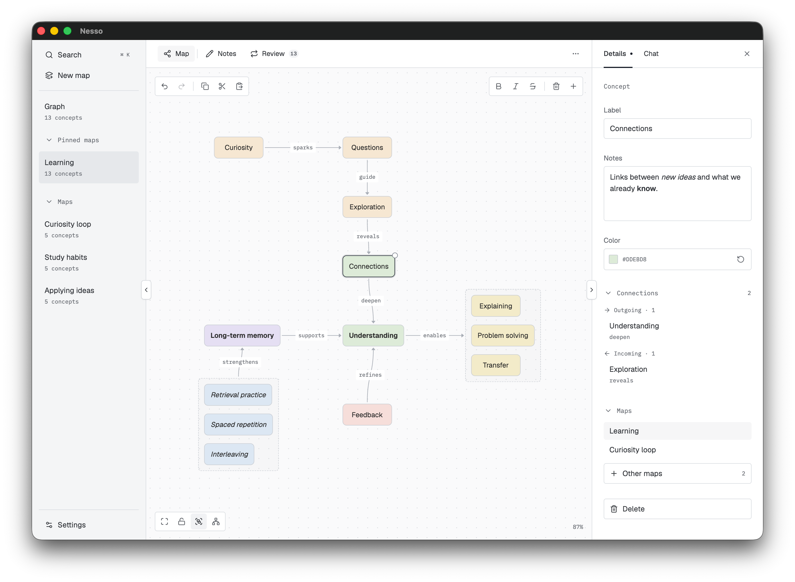

 
A desktop app for learning, with a personal knowledge graph that grows with you. Connect ideas, work through them in notes, and review what you’ve learned.
  

We often understand and remember through associations: one idea brings another to mind, and new knowledge gains meaning through what we already know. Nesso gives you a place to map these associations, follow the relations between ideas, and build on them.

Your knowledge lives in **one connected graph**, and **maps** let you focus on a project, question, or theme within it. _Coffee_, for example, can appear both on a map about energy and on one about sleep. When you edit its notes, both maps show the change, while moving it on one map leaves the other's layout as it was.

## Install

Download Nesso for **macOS, Windows, or Linux** from [nesso.how](https://nesso.how) or [GitHub Releases](https://github.com/nesso-how/nesso/releases), or try the [web demo](https://app.nesso.how). The desktop app adds AI assistance, plugin installation, the local MCP server, and automatic backups.

When you first open Nesso, a short introduction lets you connect two ideas and switch between maps. You can come back to it anytime from **Settings → About → Introduction**.

Nesso is still in beta, so we'd love to hear what worked for you and what got in your way. Share it in [Discussions](https://github.com/nesso-how/nesso/discussions).

> [!WARNING]
> Windows installers are currently unsigned and may trigger SmartScreen warnings.

## What you can do

- **Connect ideas.** Give each concept a label and Markdown notes, then draw directed relations to other concepts and name them _causes_, _depends on_, or a type of your own. A vocabulary gives you a set of relation types to reuse.
- **Work on a map.** Open a map from the Explorer, arrange ideas on the canvas, and edit whatever you select in the Inspector. You can group related maps, pin the ones you come back to, and open **Graph** whenever you want the whole picture.
- **Write and review.** The bundled **Notes** action gives each map its own Markdown notebook, and **Review** quizzes you on the map's concepts with spaced repetition. Progress on a concept carries over to every map that contains it.
- **Share your work.** The bundled **Export** action saves a map or the whole graph as JSON-LD or PNG, and **Import** merges the concepts and maps from a Nesso JSON-LD file into your graph.
- **Extend Nesso.** Plugins add actions, themes, and vocabularies. On desktop you can install published ones from **Settings → Plugins**, or [build your own](packages/plugin/README.md#create-a-plugin).
- **Ask for help with your graph.** On desktop you can chat about your graph in the Inspector using your own API key, a local model, or your ChatGPT sign-in, and external assistants can connect through the local MCP server. You can undo their edits just like your own.

## FAQ

### Where is my data stored?

On your device. The desktop app keeps everything in a data folder that you can find or move from **Settings → Local data**, while the web demo stores its data in your browser. Nesso has no account or server of its own.

To share concepts and relations, export them as JSON-LD. A backup goes further and also brings back your workspace, map notes, and review progress. On desktop, Nesso backs up automatically every 15 minutes and before a reset or restore, keeping the latest ten copies. You can choose where backups go, or restore one, in **Settings → Local data → Backup**.

### Can I sync Nesso across devices?

Not yet. You can move the data folder into a cloud-synced folder, as long as its files stay available offline and you edit from only one device at a time. Credentials always stay on the device where you entered them.

### Do I need AI to use Nesso?

No. AI is optional and off until you set it up. When you use it, requests go straight from your device to the provider you chose, or stay on your computer with a local model.

### Is it safe to install a plugin?

Before you install a plugin, Nesso shows which graph edits it can make and which capabilities it needs, such as opening files or storing its own data. Your approval covers only that package and that access.

Plugin code runs isolated from the app, so it can't reach the network, the app's interface, or your computer directly, and it opens or saves files only through Nesso. Themes and vocabularies are plain data and run no code. If a plugin edits your graph you can undo it, and removing the plugin leaves your graph intact.

### Why not let plugins do anything?

Giving plugins full access to the app would make some features easier to build, but every plugin would then need to be trusted completely. Adding limits later is hard once other plugins depend on that access. We add APIs as real use cases need them, so you can see what access a plugin gets.

## Troubleshooting

If a suspected plugin problem prevents startup, quit Nesso completely and relaunch it with `--safe-plugins`:

- **macOS:** `open -a Nesso --args --safe-plugins`
- **Windows (PowerShell):** `& "C:\path\to\Nesso.exe" --safe-plugins`
- **Linux:** `nesso --safe-plugins`, or `./Nesso-<arch>.AppImage --safe-plugins` for an AppImage.

Nesso then starts without loading installed plugins, though your plugins and documents stay as they are. To go back to normal, quit and relaunch without the flag.

To report a bug, open a [bug report](https://github.com/nesso-how/nesso/issues/new/choose) and attach the logs, which you'll find on desktop under **Help → Open Logs Folder**. Suspected vulnerabilities go through the [private reporting channel](SECURITY.md) instead.

## Documentation

- [Canvas controls and map actions](docs/guide.md): a reference for after the introduction, also available to AI chat and MCP clients as the `guide` topic of `read_docs`.
- [Architecture and glossary](docs/architecture.md): how an edit reaches the graph, how it is saved, and where the code lives.
- [Plugin SDK](packages/plugin/README.md) and [standalone example](packages/plugin/example/README.md): build an action, theme, or vocabulary.
- [Contributing](CONTRIBUTING.md): run the app, propose a change, and open a pull request.
- [Compatibility and backups](docs/compatibility.md) · [Release notes](CHANGELOG.md)

## License

[MIT](LICENSE) © 2026 Omar Desogus and Paolo Manfredotti.
