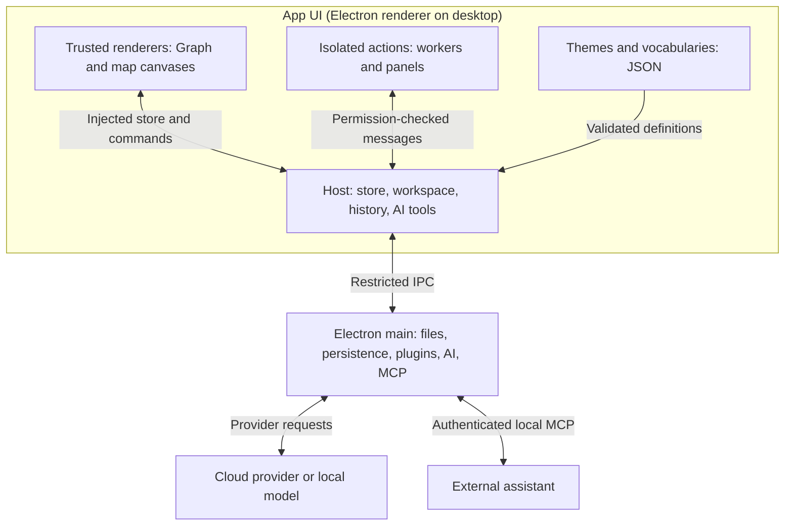

# Architecture

A concept can belong to two maps, so renaming it changes both while dragging it only changes the layout of the map you're editing. Nesso can tell these edits apart because the host owns both the graph and the workspace. The canvases draw whatever the host hands them, and plugins can request changes without ever touching the store directly.

## Glossary

| Term             | Meaning in Nesso                                                                                                                                                             |
| ---------------- | ---------------------------------------------------------------------------------------------------------------------------------------------------------------------------- |
| Graph            | The document's concepts, relation types, and directed relations. **Graph** in the Explorer opens the overview canvas.                                                        |
| Map              | A named set of concepts from the graph. Positions, label styles, and curve bends belong to the map, while concept text and relations are shared.                             |
| Workspace        | The maps and their organization, plus navigation state such as the active map and saved viewports.                                                                           |
| `mapGraph`       | The graph the host prepares for a canvas or action. On a map it includes the member concepts, their presentation, and relations between them. It is derived, never saved.    |
| Vocabulary       | A plugin definition that supplies named relation types and the default type for new connections.                                                                             |
| Host             | The application code that owns the store, interprets editing commands, and manages persistence and plugin access.                                                            |
| Trusted renderer | A built-in canvas component that receives a store and commands from the host. Not the same as Electron's _renderer process_, which runs the whole app UI, canvases included. |
| Isolated action  | A plugin command that runs in a worker, or opens a sandboxed panel. It interacts with the host through the plugin SDK.                                                       |

## Follow an edit

Suppose a plugin uppercases the labels on a map:

1. The host invokes the action in its worker with a snapshot for that map. The action reads the labels and sends one batch of `concept.label` operations through its SDK client.
2. The [action channel](../src/plugins/action-channel.ts) checks that the invocation is still active, that each write was declared, and that the snapshot revision is current, so an edit calculated before the graph changed is rejected. Interactive panels go through the same checks. Themes and vocabularies never take this path, because the host reads them as plain data.
3. The host calls [`applyOperations`](../src/store/create.ts). It evaluates the ordered batch against the current state, validates the result, and publishes one Zustand update. If any edit fails, none of the labels change and no history entry is created. The map canvas and Inspector subscribe to the same store instance and see the same result.
4. [Document history](../src/store/history.ts) records the changed values, so undo restores all the previous labels and redo restores the new ones without rerunning the plugin. History lasts for the app session and covers graph and map edits. Changing the selection, navigating, setting a preference, or saving a plugin's private notes doesn't add a step to it.

The Inspector, trusted renderers, and AI tools reach the same editing API. They differ in how a request gets there:

- A renderer turns a drag into coordinates.
- The [workspace](../src/components/app/GraphWorkspace.tsx) handles shared commands such as cut and delete.
- Chat holds document edits until the response succeeds.
- External MCP writes wait for approval in the app.

## From memory to disk

An accepted edit shows up immediately, while [persistence](../src/store/persistence.ts) subscribes to the store, tracks which records changed, and queues their saves. On desktop a [file adapter](../electron/persistence/file-storage.ts) writes each record to a temporary file and then renames it into place, and in the web demo the same record interface is backed by [IndexedDB](../src/store/storage.ts).

The desktop data folder shown in **Settings → Local data** contains four application records:

| File                  | What it keeps                                                                                            |
| --------------------- | -------------------------------------------------------------------------------------------------------- |
| `document.json`       | The document identity, graph, and workspace. Saving graph and maps together keeps membership consistent. |
| `preferences.json`    | App choices such as language, theme, and panel settings.                                                 |
| `conversation.json`   | The saved AI chat.                                                                                       |
| `plugin-storage.json` | Private plugin records for this document, including map notes and review progress.                       |

At startup the host validates these records and migrates supported versions before autosave begins. If a record can't be read, Nesso reports it and won't overwrite it automatically. When you close the desktop app, Nesso waits for pending saves, and if one fails it tells you and lets you keep the app open.

By default the data folder is the Electron user profile. If you move it, the profile still holds `data-location.json` (where to find the records), `plugins/` (installed packages), and `ai-connections.enc` (encrypted connection details). Automatic backups default to `backups/` in that profile and can be placed elsewhere. An app backup includes the four application records, while a JSON-LD export carries only graph data for sharing. See [compatibility and migrations](compatibility.md) for the format index and restore policy.

## Where to work

| Change                        | Starting point                                                                                                                                                                                                                                                         |
| ----------------------------- | ---------------------------------------------------------------------------------------------------------------------------------------------------------------------------------------------------------------------------------------------------------------------- |
| Editing, history, persistence | [`src/store/`](../src/store/) implements the store, [`core`](../packages/core/) defines its shared contracts, and [`schema`](../packages/schema/) owns the graph model and JSON-LD.                                                                                    |
| App UI and gestures           | [`src/components/app/`](../src/components/app/) and [`src/graph/`](../src/graph/) own the workspace. [`concept-map`](../packages/concept-map/) draws editable maps and [`knowledge-graph`](../packages/knowledge-graph/) draws the graph overview.                     |
| Plugins                       | [`src/plugins/`](../src/plugins/) hosts the runtime. The [plugin SDK](../packages/plugin/) and [standalone example](../packages/plugin/example/) are the starting point for authors.                                                                                   |
| Bundled actions               | [Notes](../plugins/notes/), [Review](../plugins/review/), [Import](../plugins/import/), and [Export](../plugins/export/) use the same contracts as external plugins.                                                                                                   |
| Bundled definitions           | The [base vocabulary](../plugins/base-vocab/) and the [Kernel](../plugins/kernel-theme/), [Paper](../plugins/paper-theme/), and [Mist](../plugins/mist-theme/) themes.                                                                                                 |
| Shared building blocks        | [`ui`](../packages/ui/) for React controls, [`i18n`](../packages/i18n/) for translations, [`errors`](../packages/errors/) for structured failures.                                                                                                                     |
| AI and desktop services       | [`ai`](../packages/ai/) defines chat and MCP contracts, and [`src/ai/`](../src/ai/) runs the tools against the host. [`electron/`](../electron/) owns provider connections, the MCP server, native files, plugin installation, desktop persistence, and the app shell. |
